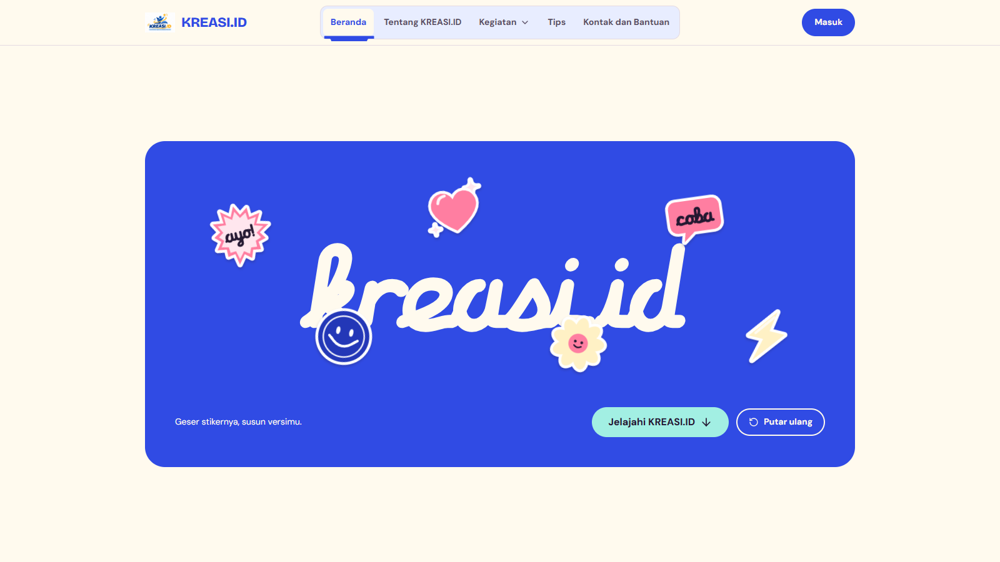
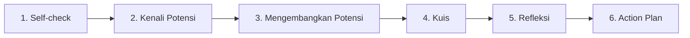
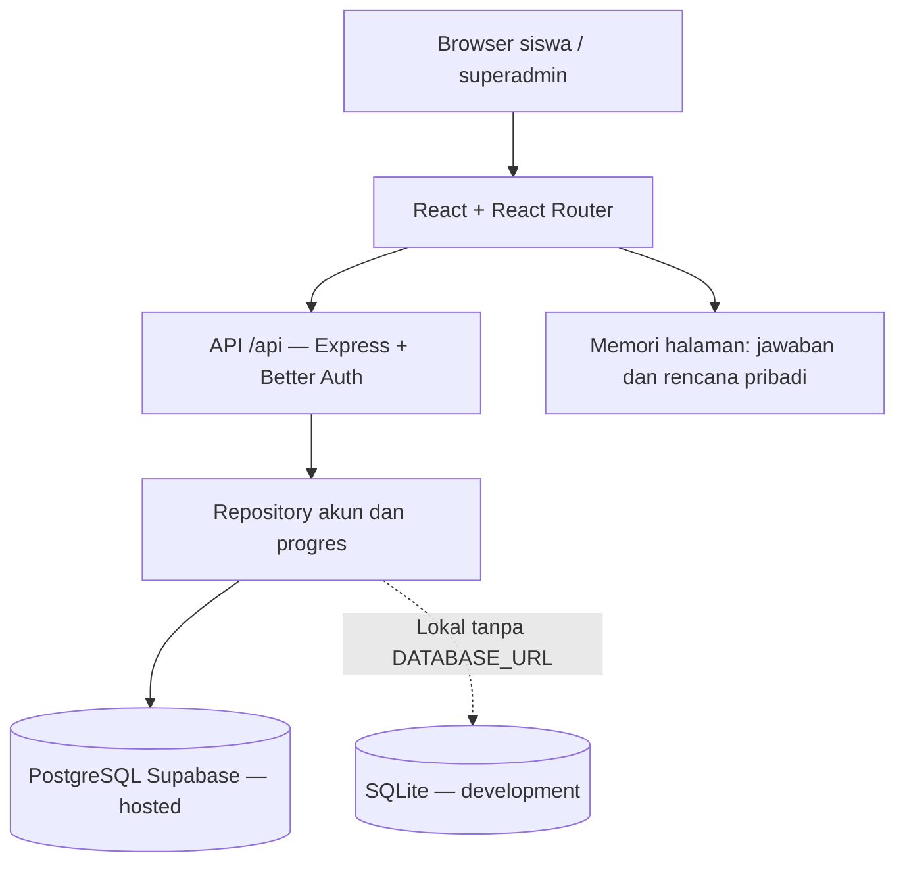

<p align="center">
  
</p>

<h1 align="center">KREASI.ID</h1>

<p align="center">
  <strong>Kenali, Refleksikan, Eksplorasi, dan Aktualisasikan Potensi Diri.</strong><br />
  Media Bimbingan dan Konseling digital untuk membantu siswa SMP mengenali potensi,
  memahami diri, dan menyusun langkah pengembangan yang bisa dilakukan sehari-hari.
</p>

<p align="center">
  <a href="#fitur-utama">Jelajahi Fitur</a> &middot;
  <a href="#mulai-di-lokal">Mulai di Lokal</a> &middot;
  <a href="./docs/deploy-vercel.md">Panduan Deploy</a> &middot;
  <a href="./PRD.md">Dokumen Produk</a>
</p>

<p align="center">
  
  
  
  
  
  
  
</p>

---

## Daftar Isi

1. [Tentang Proyek](#tentang-proyek)
2. [Fitur Utama](#fitur-utama)
3. [Perjalanan Enam Kegiatan](#perjalanan-enam-kegiatan)
4. [Arsitektur Sistem](#arsitektur-sistem)
5. [Tech Stack](#tech-stack)
6. [Struktur Repository](#struktur-repository)
7. [Mulai di Lokal](#mulai-di-lokal)
8. [Konfigurasi Environment](#konfigurasi-environment)
9. [Deployment Vercel](#deployment-vercel)
10. [Pengujian dan Perintah](#pengujian-dan-perintah)
11. [Privasi dan Akses](#privasi-dan-akses)
12. [Dokumentasi dan Pengelola](#dokumentasi-dan-pengelola)

---

## Tentang Proyek

**KREASI.ID** adalah website pendukung layanan Bimbingan dan Konseling (BK) bagi siswa SMP kelas VII–IX. Siswa diajak mengenali minat dan kemampuan, mempelajari cara mengembangkan potensi, menguji pemahaman, lalu membuat rencana tindakan pribadi.

Pengalaman belajar dirancang dalam enam kegiatan berurutan. Siswa dapat melihat progres, melanjutkan langkah yang sudah terbuka, serta mengunjungi kembali kegiatan sebelumnya. Superadmin mengelola persetujuan akun sebelum siswa menggunakan kegiatan.

Identitas visual memadukan biru `#304BE4`, cream `#FFFAEE`, pink `#FF7EA1`, dan mint `#A2EFE3`, dengan tipografi **Bricolage Grotesque** dan **DM Sans**. Panel membulat, stiker yang dapat digeser, serta animasi tombol memberi suasana yang ramah bagi siswa.

Website ini merupakan media pendamping kegiatan BK. Hasil latihan dipakai sebagai bahan mengenali diri dan berdiskusi dengan guru BK, bukan sebagai diagnosis atau penentuan bakat secara mutlak.

## Fitur Utama

| Fitur | Pengalaman yang tersedia |
| --- | --- |
| **Beranda interaktif** | Intro satu layar dengan stiker yang bisa digeser, tombol jelajah, dan tombol putar ulang. |
| **Navigasi perjalanan** | Enam kegiatan dengan indikator progres, langkah aktif, dan status terkunci/selesai/dilewati. |
| **Akun dan verifikasi** | Daftar, login, status menunggu persetujuan, serta pembatasan akses berdasarkan status akun. |
| **Dashboard superadmin** | Daftar pengguna, filter status, jumlah akun, pagination, serta keputusan persetujuan atau penolakan. |
| **Materi potensi diri** | Penjelasan minat, bakat, kemampuan, dan contoh latihan pengembangan potensi. |
| **Kuis pemahaman** | Kuis lokal; integrasi Google Forms dapat diaktifkan melalui konfigurasi, dengan latihan cadangan. |
| **Refleksi pribadi** | Pertanyaan panduan untuk menghubungkan materi dengan pengalaman siswa. |
| **Action Plan** | Form rencana tindakan, ringkasan yang dapat diedit, dan salinan teks untuk catatan pribadi. |
| **Tips dan bantuan** | Panduan penggunaan, bantuan saat aktivitas bermasalah, dan kanal kontak BK jika dikonfigurasi. |
| **Tampilan responsif** | Layout untuk desktop, tablet, dan ponsel dengan komponen serta token desain yang konsisten. |

## Perjalanan Enam Kegiatan



| Langkah | Tujuan | Halaman |
| --- | --- | --- |
| **1. Self-check** | Mengamati ketertarikan dan kemampuan dari kegiatan sehari-hari. | `/self-check` |
| **2. Kenali Potensi** | Memahami minat, bakat, kemampuan, dan potensi diri. | `/kenali-potensi` |
| **3. Mengembangkan Potensi** | Menemukan cara berlatih dan membangun kebiasaan. | `/mengembangkan-potensi` |
| **4. Kuis** | Memeriksa pemahaman terhadap materi. | `/kuis` |
| **5. Refleksi** | Menuliskan hal yang dipelajari dan ingin dicoba. | `/refleksi` |
| **6. Action Plan** | Menyusun langkah, dukungan, waktu, dan evaluasi rencana. | `/action-plan` |

Beranda, Tentang, Tips, serta Kontak dan Bantuan dapat dibuka tanpa login. Kegiatan memerlukan akun yang sudah disetujui superadmin. Aturan urutan diperiksa oleh frontend dan API, termasuk saat URL kegiatan dibuka langsung. **Self-check dan Refleksi dapat dilewati** melalui pilihan yang tersedia; langkah yang telah terbuka tetap dapat dikunjungi kembali.

## Arsitektur Sistem



Di lokal, Vite melayani frontend pada port **5173** dan meneruskan `/api` ke Express pada port **3001**. Launcher menunggu API siap sebelum menjalankan frontend.

Di Vercel, satu proyek melayani aset frontend melalui CDN dan API melalui Function Node.js di `api/index.js`. Frontend menggunakan `/api` pada origin yang sama. Koneksi database, autentikasi, dan pemeriksaan progres tetap berada di backend.

## Tech Stack

| Bagian | Teknologi |
| --- | --- |
| Bahasa | JavaScript dengan ES Modules |
| Antarmuka | React 19, React Router 7, Vite 6 |
| Styling | CSS Modules, CSS custom properties, font lokal melalui Fontsource |
| Ikon | Lucide React |
| Backend | Node.js 24, Express 5 |
| Autentikasi | Better Auth 1.7, sesi berbasis cookie |
| Database hosted | PostgreSQL Supabase, `pg` Pool, Kysely untuk adapter auth |
| Database lokal | SQLite melalui `node:sqlite` saat `DATABASE_URL` kosong |
| Pengelolaan paket | npm workspaces dan satu `package-lock.json` di root |
| Pengujian | Node.js Test Runner, Playwright, embedded PostgreSQL untuk pengujian integrasi |
| Hosting | Vercel CDN dan Node.js Function |

## Struktur Repository

```text
KREASI.ID/
├── backend/                     # API, auth, repository, dan utilitas database
│   ├── .env.example             # Template konfigurasi tanpa kredensial
│   ├── certs/                   # Sertifikat CA untuk koneksi database
│   ├── src/
│   │   ├── domain/              # Aturan perjalanan enam kegiatan
│   │   ├── routes/              # Endpoint akun, admin, kegiatan, dan konfigurasi
│   │   ├── app.js               # Middleware, routing, dan error handler
│   │   ├── auth.js              # Better Auth dan koneksi penyimpanan
│   │   └── server.js            # Server HTTP lokal / standalone
│   └── test/                    # Pengujian backend dan integrasi
├── frontend/                    # Aplikasi React
│   ├── public/
│   ├── src/
│   │   ├── assets/              # Logo dan ilustrasi
│   │   ├── components/          # Layout, navigasi, dan komponen UI
│   │   ├── content/             # Materi, pertanyaan, dan petunjuk
│   │   ├── features/            # Auth, perjalanan, kuis, refleksi, Action Plan
│   │   ├── pages/               # Halaman aplikasi
│   │   ├── services/            # Klien API
│   │   └── styles/              # Token dan gaya global
│   ├── test/
│   └── dev-api-proxy.mjs        # Proxy pengembangan yang menangani restart
├── api/index.js                 # Entry point Function Vercel
├── scripts/dev.mjs              # Launcher frontend + backend
├── supabase/migrations/         # Migrasi PostgreSQL versioned
├── e2e/                         # Pengujian browser
├── docs/                        # Panduan, audit, dan tangkapan layar
├── stitch_desain_website_kreasi.id_bk/  # Referensi desain dari Stitch
├── PRD.md                       # Kebutuhan produk
├── design.md                    # Pedoman desain
├── structure.md                 # Struktur teknis lengkap
├── TASKLIST.md                  # Daftar pekerjaan
├── package.json                 # Perintah dan konfigurasi workspace
└── vercel.json                  # Build, Function, dan routing deployment
```

## Mulai di Lokal

### Prasyarat

- **Node.js 24.x** beserta npm.
- **Git** untuk mengambil repository.
- PostgreSQL hanya diperlukan jika ingin memakai database hosted; pengembangan awal dapat menggunakan SQLite.

### 1. Ambil kode dan pasang dependensi

```powershell
git clone https://github.com/tegokkk/KREASI.ID.git
cd KREASI.ID
npm ci
```

### 2. Siapkan konfigurasi pada clone baru

```powershell
Copy-Item backend/.env.example backend/.env.local
```

Edit `backend/.env.local` sesuai kebutuhan. Jika sudah memiliki konfigurasi lokal, gunakan file tersebut. Untuk mencoba dengan SQLite, biarkan `DATABASE_URL` kosong; tabel lokal dan secret development disiapkan saat backend pertama berjalan.

### 3. Jalankan aplikasi

```powershell
npm run dev
```

Buka **[http://localhost:5173](http://localhost:5173)** setelah URL Vite tampil. Backend berjalan pada **[http://localhost:3001](http://localhost:3001)**. Perintah gabungan juga dapat dijalankan dari folder `frontend`.

Launcher menggunakan kembali backend KREASI.ID yang sudah sehat. Saat backend restart, proxy menunggu hingga 8 detik; request baca dapat dicoba kembali, sedangkan form/login yang sudah diteruskan tidak dikirim ulang. Jika backend yang dipakai bersama berhenti, launcher mencoba menjalankannya kembali setelah jeda 3 detik. Watcher backend milik launcher yang masih hidup tetap menangani restart. `Ctrl+C` menghentikan proses yang dibuat launcher.

Untuk dua terminal terpisah, jalankan `npm run dev:backend` di terminal pertama dan `npm run dev:frontend` di terminal kedua, keduanya dari root.

### 4. Buat superadmin pertama

Pada database baru, tentukan `SUPERADMIN_EMAIL` di `backend/.env.local`, lalu jalankan:

```powershell
npm run create-superadmin --workspace=backend
```

Jika `SUPERADMIN_PASSWORD` kosong, script menghasilkan kata sandi acak dan menampilkannya sekali di terminal. Simpan secara pribadi, lalu login melalui `/login` dan buka `/superadmin`. Akun siswa yang mendaftar melalui `/daftar` perlu ditinjau dari dashboard tersebut. Script bootstrap membuat akun baru dan akan menolak email yang sudah terdaftar.

## Konfigurasi Environment

Gunakan [backend/.env.example](backend/.env.example) sebagai referensi. File privat lokal berada di `backend/.env.local` dan dikecualikan dari Git.

| Variabel | Kegunaan |
| --- | --- |
| `PORT` | Port backend; default `3001`. |
| `DATABASE_URL` | Connection string PostgreSQL. Wajib pada produksi; kosong untuk SQLite lokal. |
| `DATABASE_MIGRATION_URL` | Koneksi Direct/Session pooler untuk menjalankan migrasi secara terpisah. |
| `DATABASE_SCHEMA` | Namespace database; gunakan target berbeda untuk development, Preview, dan Production. |
| `DATABASE_POOL_MAX` | Batas pool koneksi; nilai yang disiapkan adalah `3`. |
| `DATABASE_SSL_CA` | CA PEM pengganti jika diperlukan; CA Supabase sudah disertakan. |
| `BETTER_AUTH_SECRET` | Secret autentikasi minimal 32 karakter; wajib pada produksi. |
| `BETTER_AUTH_URL` | Origin autentikasi, misalnya `http://localhost:3001` saat development. |
| `AUTH_TRUSTED_ORIGINS` | Daftar origin yang diizinkan, dipisahkan koma. |
| `AUTH_DATABASE_PATH` | Lokasi SQLite lokal opsional; default `backend/data/accounts.sqlite`. |
| `SUPERADMIN_EMAIL` / `SUPERADMIN_PASSWORD` | Kredensial bootstrap yang hanya digunakan saat menjalankan script pembuatan admin. |
| `QUIZ_MODE` | `local` atau `google-forms`; mode formulir memerlukan URL valid. |
| `QUIZ_FORM_URL` | URL responden Google Forms jika integrasi diaktifkan. |
| `QUIZ_RETENTION_DAYS` | Informasi masa simpan untuk layanan kuis eksternal; bukan penjadwal penghapusan otomatis. |
| `BK_CONTACT_URL` | Kanal bantuan opsional; jika kosong, aplikasi mengarahkan siswa menemui guru BK di sekolah. |

Untuk PostgreSQL baru, isi koneksi dan schema tujuan, lalu jalankan `npm run db:migrate` sebelum memakai API. Migrasi tidak dijalankan otomatis pada build atau cold start. Runner membaca `DATABASE_MIGRATION_URL` bila tersedia dan mengganti token schema pada SQL; detail ada pada [panduan database dan deployment](docs/deploy-vercel.md#migrasi-berikutnya-dan-pemeliharaan).

## Deployment Vercel

Import repository **`tegokkk/KREASI.ID`** ke satu proyek Vercel dengan konfigurasi:

| Pengaturan | Nilai |
| --- | --- |
| Production Branch | `main` |
| Root Directory | `./` — root repository |
| Framework Preset | Vite |
| Node.js | `24.x` |
| Install Command | `npm ci` |
| Build Command | `npm run build` |
| Output Directory | `frontend/dist` |

Siapkan `DATABASE_URL` dan koneksi migrasi pada konfigurasi lokal, kemudian jalankan:

```powershell
npm run deploy:prepare
npm run deploy:check
```

`deploy:prepare` menghasilkan file privat untuk dua target dan mempertahankan secret yang sudah ada. `deploy:check` memeriksa koneksi database serta konfigurasi kedua schema; migrasi target harus sudah diterapkan agar pemeriksaan lulus.

| File privat | Cakupan variabel Vercel | Schema |
| --- | --- | --- |
| `backend/.env.preview.local` | Preview saja | `kreasi_preview` |
| `backend/.env.production.local` | Production saja | `kreasi` |

Masukkan nilai masing-masing file ke **Environment Variables** proyek, sesuai cakupannya. Preview dan Production menggunakan secret berbeda; schema tersebut adalah pemisahan logis dalam satu database. Koneksi migrasi dan kredensial bootstrap tidak diperlukan oleh Function untuk melayani pengguna.

Aktifkan akses **System Environment Variables** Vercel. Konfigurasi aplikasi menentukan origin HTTPS dari variabel sistem tersebut. Jika origin perlu ditetapkan sendiri, isi `BETTER_AUTH_URL` dan `AUTH_TRUSTED_ORIGINS` dengan domain HTTPS yang sesuai. Setelah mengubah environment, buat deployment baru atau lakukan Redeploy.

Sesudah deployment tersedia, periksa URL sebenarnya:

```powershell
npm run deploy:check-url -- https://DOMAIN-ANDA.vercel.app
```

Ganti URL contoh dengan domain deployment. Lanjutkan pemeriksaan browser untuk daftar, login, persetujuan superadmin, urutan kegiatan, dan logout. Panduan lengkap, akses Preview yang dilindungi, serta migrasi tersedia di [docs/deploy-vercel.md](docs/deploy-vercel.md).

## Pengujian dan Perintah

Jalankan perintah berikut dari root repository:

| Perintah | Fungsi |
| --- | --- |
| `npm run dev` | Menjalankan backend dan frontend bersama. |
| `npm run dev:backend` | Menjalankan backend dalam watch mode. |
| `npm run dev:frontend` | Menjalankan Vite saja; memerlukan backend terpisah. |
| `npm test` | Menguji API, auth, approval, progres, database, proxy development, dan konfigurasi deploy. |
| `npm run test:e2e` | Membuat build `dist-e2e` lalu menguji alur melalui browser. |
| `npm run build` | Membuat bundle produksi pada `frontend/dist`. |
| `npm start` | Menjalankan Express standalone untuk API dan hasil build; tetapkan environment produksi untuk rilis. |
| `npm run db:migrate` | Menerapkan migrasi PostgreSQL pada target yang dikonfigurasi. |
| `npm run db:import-sqlite` | Mengimpor akun dan metadata dari SQLite ke schema PostgreSQL kosong. |
| `npm run create-superadmin --workspace=backend` | Membuat akun superadmin baru. |
| `npm run deploy:prepare` | Menyiapkan file environment privat Preview dan Production. |
| `npm run deploy:check` | Memeriksa konfigurasi dan database hosted sebelum deploy. |
| `npm run deploy:check-url -- <URL-HTTPS>` | Menguji routing, readiness, dan respons API deployment. |
| `npm run test:hosted` | Menguji API lokal terhadap schema Supabase Preview dengan fixture sementara. |

Tes browser memakai Chrome secara default. Untuk menggunakan Chromium Playwright pada PowerShell:

```powershell
npx playwright install chromium
$env:BROWSER_CHANNEL = 'chromium'
npm run test:e2e
```

Endpoint **`GET /api/health`** memeriksa proses HTTP. **`GET /api/ready`** memeriksa kesiapan layanan dan penyimpanan. Hasil build serta pengujian diabaikan watcher Vite agar tidak memuat ulang halaman development.

## Privasi dan Akses

- **Isian pribadi bersifat sementara.** Jawaban latihan lokal, refleksi, dan isi Action Plan berada di memori halaman; muat ulang atau menutup halaman dapat menghapus isian. Siswa dapat menyalin Action Plan ke catatan pribadi.
- **Progres terpisah dari jawaban.** Backend menyimpan akun, sesi, metadata progres, catatan peninjauan, dan data operasional autentikasi; bukan isi bebas jawaban kegiatan lokal.
- **Persetujuan diperiksa di server.** Role dan status akun tidak dapat ditentukan melalui input pendaftaran. Endpoint kegiatan memerlukan akun yang disetujui; endpoint admin memerlukan role superadmin.
- **Sesi produksi memakai cookie aman.** Autentikasi menggunakan cookie HttpOnly, Secure pada HTTPS produksi, SameSite, pemeriksaan origin, dan pembatasan percobaan pada endpoint auth.
- **Rahasia berada di backend.** File `.env`, SQLite lokal, dan secret tidak masuk Git. Jangan menambahkan prefix `VITE_` pada rahasia atau connection string.
- **Database hosted menggunakan TLS.** Verifikasi sertifikat dan hostname tetap aktif. Schema aplikasi memakai RLS sebagai perlindungan tambahan dan tidak diberikan kepada role Data API publik.
- **Layanan eksternal memiliki kebijakan sendiri.** Jika Google Forms diaktifkan, pengelola perlu mengatur akses, informasi masa simpan, dan penghapusan respons pada layanan tersebut.

## Dokumentasi dan Pengelola

| Dokumen | Isi |
| --- | --- |
| [PRD.md](PRD.md) | Tujuan, kebutuhan, alur pengguna, dan kriteria penerimaan. |
| [design.md](design.md) | Identitas visual dan pedoman antarmuka. |
| [structure.md](structure.md) | Struktur folder, tanggung jawab modul, dan stack. |
| [TASKLIST.md](TASKLIST.md) | Daftar pengerjaan serta catatan validasi. |
| [Panduan deploy](docs/deploy-vercel.md) | Konfigurasi Vercel, environment, migrasi, dan pemeriksaan deployment. |
| [Audit deploy](docs/audit-deploy-vercel.md) | Temuan teknis dan status kesiapan deployment. |
| [Instrumen pengujian](docs/instrumen-pengujian-dan-telaah.md) | Bahan telaah dan pengujian bersama pengelola/guru BK. |

Repository dikelola oleh **[tegokkk](https://github.com/tegokkk)**. Laporkan bug melalui [GitHub Issues](https://github.com/tegokkk/KREASI.ID/issues) dengan langkah reproduksi, perangkat/browser, dan hasil yang diharapkan. Gunakan data contoh saat melaporkan masalah.

Repository belum menyertakan file lisensi. Hubungi pengelola untuk ketentuan penggunaan atau distribusi kode dan aset.

---

<p align="center">
  <strong>KREASI.ID</strong><br />
  Kenali potensimu. Refleksikan pengalamanmu. Mulai langkahmu.
</p>
